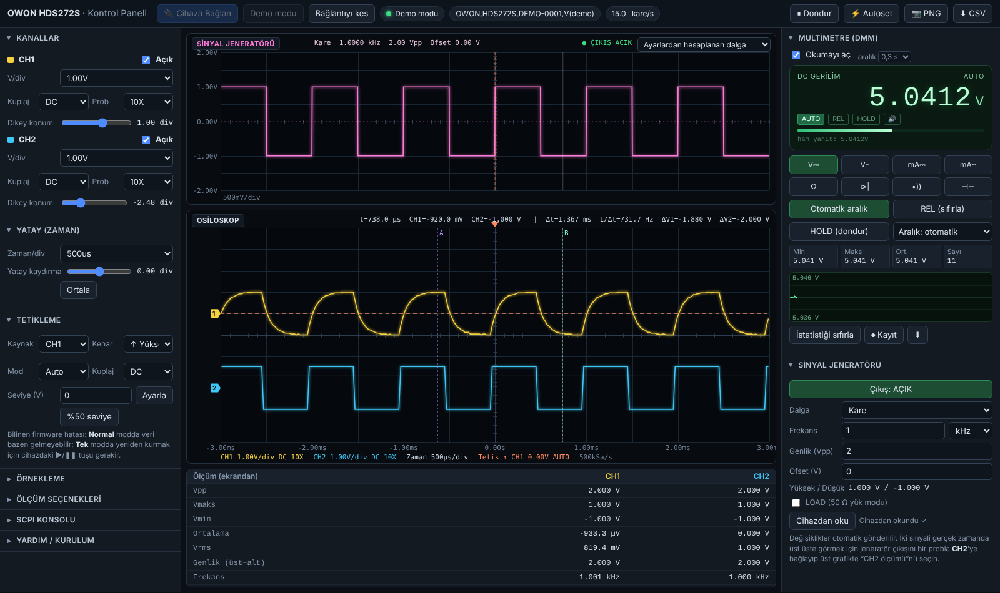

# OWON HDS Panel

OWON **HDS272S** (ve aynı ailedeki HDS200 serisi) el tipi osiloskop / multimetre / sinyal jeneratörünü bilgisayardan kontrol etmek için Windows masaüstü uygulaması.



## Özellikler

- **Osiloskop:** CH1/CH2 canlı dalga, V/div, kuplaj, prob, dikey konum, zaman/div, yatay kaydırma, tetikleme (kaynak, kenar, seviye, mod), örnekleme modu, Autoset, dondurma
- **Ölçümler:** Vpp, Vmaks, Vmin, ortalama, Vrms, genlik, frekans, periyot, görev oranı, yükselme/düşme süresi; isteğe bağlı olarak cihazın kendi ölçümleri
- **İmleçler:** tıkla → A, Shift+tıkla → B; Δt, 1/Δt, ΔV
- **Sinyal jeneratörü:** 12 dalga tipi, frekans, genlik, ofset, görev oranı, simetri, çıkış aç/kapa. Üst grafikte jeneratör sinyali, alt grafikte osiloskop aynı zaman ekseninde
- **Multimetre:** DC/AC gerilim, akım, direnç, diyot, süreklilik (bip), kapasite; otomatik aralık, REL, HOLD, min/maks/ortalama, zaman grafiği, CSV kaydı
- **Dışa aktarma:** PNG ekran görüntüsü, CSV dalga verisi
- **SCPI konsolu:** cihaza doğrudan komut gönderme
- **Demo modu:** cihaz olmadan arayüzü deneme

## İndirme ve kullanma

1. [Releases](../../releases) sayfasından en son sürümü indirin:
   - `OWON-HDS-Panel-Tasinabilir-x.y.z.exe`: kurulum gerektirmez, çift tıklayıp çalıştırın
   - `OWON-HDS-Panel-Kurulum-x.y.z.exe`: kurulum yapar, masaüstü kısayolu oluşturur
2. Cihazı USB-C kablosuyla bağlayın. Uygulama kendiliğinden bağlanır.

> Uygulama dijital olarak imzalı olmadığı için Windows "Bilgisayarınız korundu" uyarısı gösterebilir: **Ek bilgi → Yine de çalıştır**.

### Sürücü hakkında

Ek bir program (Zadig vb.) gerekmez:

- Owon'un kendi PC yazılımı kuruluysa sürücü (libusb-win32 / libusbK) zaten vardır ve uygulama onunla çalışır.
- Hiç sürücü yoksa uygulama bunu algılar ve **"Sürücüyü otomatik kur"** düğmesi gösterir. Bu düğme Windows'un kendi WinUSB sürücüsünü cihaza atar (bir kez yönetici izni ister).
- Owon'un kendi programı açıkken cihaz kilitlenebilir; bu uygulamayı kullanırken onu kapatın.

### Web sürümü

`web/owon-hds272s-panel.html` dosyası Chrome/Edge'de WebUSB ile çalışan tek dosyalık bir sürümdür. Windows'ta WinUSB sürücüsü gerektirir.

## Kaynaktan derleme

Gereksinim: [Node.js](https://nodejs.org/) 22

```bash
npm install
npm start        # geliştirme modunda çalıştır
npm run dist     # dist/ klasörüne Windows .exe dosyalarını üret
```

GitHub'da yeni bir **Release** yayınlandığında `.github/workflows/windows-derleme.yml` iş akışı exe dosyalarını otomatik derleyip Release'e ekler.

## Proje yapısı

| Dosya | Görevi |
|---|---|
| `main.js` | Electron ana süreci, pencere ve IPC |
| `preload.js` | Arayüz ile ana süreç arasındaki köprü |
| `usb-backends.js` | USB iletişimi (libusbK → libusb0 / libusbK / WinUSB; yedek olarak node-usb) ve SCPI sorgu mantığı |
| `win-driver.js` | Windows sürücü teşhisi ve otomatik WinUSB kurulumu |
| `renderer/index.html` | Arayüz (osiloskop, jeneratör, multimetre) |
| `native/win-x64/` | `libusbK.dll` ve `dpscat.exe` ([libusbK](https://github.com/mcuee/libusbk) projesinden) |
| `web/` | Tarayıcı (WebUSB) sürümü |

## Teşekkürler

- [seritools/owowon](https://github.com/seritools/owowon): HDS serisi USB protokolünün çözümlenmesi ve bilinen firmware hataları
- [mcuee/libusbk](https://github.com/mcuee/libusbk): libusbK.dll ve dpscat.exe (BSD / LGPL lisansları `native/` klasöründe)
- OWON HDS200 Series SCPI Protocol dokümanı

## Lisans

MIT, bkz. [LICENSE](LICENSE). `native/` klasöründeki üçüncü taraf dosyalar kendi lisanslarına tabidir.

Bu proje OWON ile bağlantılı değildir. "OWON" kendi sahibinin ticari markasıdır.
